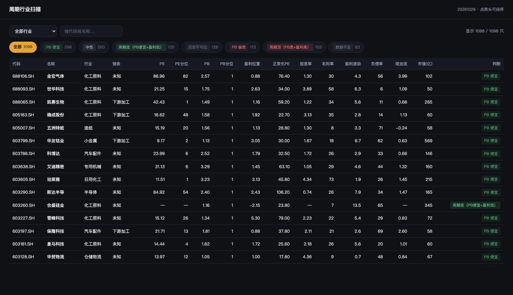

# A股周期行业估值扫描

用 **PB 分位 + 盈利位置** 判断周期股贵不贵，而不是 PE。

单文件脚本，自带数据，不需要 Tushare token 就能跑。

```bash
pip install pandas pyarrow
python -m cyclical -n 20
```



## 为什么不用 PE

周期股的当期 PE 会在盈利顶部变得极低。看招商轮船 2026-10-29：

| 指标 | 数值 | 近 10 年分位 | 看起来 |
|---|---:|---:|---|
| PE(TTM) | 9.45 | **8%** | 十年最便宜 |
| PB | 2.76 | **94%** | 十年最贵 |
| 盈利位置 | 2.69 | — | 盈利是中位数的 2.7 倍 |

**同一只股票，PE 说便宜，PB 说贵。** 因为 PE 的分母（盈利）在周期顶部，而 PB 的分母（净资产）不会。

用中位盈利算，它的正常化 PE 是 **74.3 倍**，而不是 9.45。

## 三个指标各管一件事

| 指标 | 算法 | 回答的问题 |
|---|---|---|
| **PB 分位** | 当前 PB 在近 130 个月里的位置 | 现在是贵还是便宜 |
| **盈利位置** | 最新扣非净利润 ÷ 10 年中位扣非净利润 | 盈利是不是在周期顶 |
| **正常化 PE** | 总市值 ÷ 10 年中位扣非净利润 | 如果盈利回到常态，这值多少钱 |

盈利位置用**扣非净利润**而不是 EPS：EPS 会被股本变动（增发、回购、转增）扭曲，但经营本身没变。

## 分类

按 PB 分位和盈利位置分成五类：

```
周期顶（PB贵+盈利高）   PB 分位 ≥70 且 盈利位置 ≥1.5
周期底（PB便宜+盈利低） PB 分位 ≤30 且 盈利位置 ≤0.7
PB 便宜 / PB 偏贵       单看 PB 分位
中性                    其余
历史不可比              中位净利润为负或接近 0
```

**「历史不可比」很重要**：重组、借壳、连年亏损的公司，中位利润接近 0，任何分位计算都会得出天文数字。这类不给结论。

## 产业链分类

面板里的「链条」列按**主营业务原文**的关键词判定（上游资源 / 中游冶炼 / 下游加工 / 一体化），鼠标悬停可看原文。

这个维度解释了为什么同一行业内部估值分位会反向——铝行业实测：

| 链条 | 只数 | PB分位中位 | 毛利率 | 盈利波动 |
|---|---:|---:|---:|---:|
| 一体化（云铝、南山、中铝） | 6 | **64%** | 22% | 5.2 |
| 下游加工（华峰、明泰、亚太） | 13 | **23%** | 10% | 2.7 |

上游在商品涨价时先受益，下游的毛利同时被挤压，两边估值分位天然反向。

> ⚠️ 但**全市场**看这个规律不明显（上游 42 / 下游 39 / 一体化 37）。产业链位置只在**同一行业内**可比，不能当全市场因子用。

## 用法

```bash
# 最便宜在前（PB 分位）
python -m cyclical -n 20

# 最贵在前 —— 找陷阱用这个
python -m cyclical -s pb_desc -n 20

# 看单个行业
python -m cyclical -i 铝 -n 20
python -m cyclical -i "铜,铝,黄金,小金属"

# 生成 HTML 面板
python -m cyclical --html output/cyclical.html

# 导出 CSV
python -m cyclical --csv output/cyclical.csv
```

参数：

| 参数 | 说明 |
|---|---|
| `-i, --industry` | 行业名，逗号分隔 |
| `-n, --top` | 显示前 N 只（默认 30） |
| `-s, --sort` | `pb_asc` / `pb_desc` / `earn` / `pe_asc` |
| `--min-cap` | 最小市值（亿），默认 50 |
| `--html` / `--csv` | 输出面板 / 表格 |

## 数据

`data/` 下 4 个 parquet，共约 10 MB，直接随仓库提供：

| 文件 | 内容 |
|---|---|
| `valuation_panel.parquet` | 130 个月 × 5831 只的 PB / PE_TTM / 股息率 |
| `snapshot.parquet` | 最新快照（价格、市值、行业） |
| `financials.parquet` | 年报财务（扣非净利润、毛利率、负债率、每股经营现金流） |
| `company.parquet` | 主营业务原文 + 产业链标签 |

数据截至 **2026-10-29**，来源 Tushare Pro。

## 已知局限

1. **PB 分位不能跨公司比**——它是纵向的（相对自己历史）。铝行业里华峰 1% 和云铝 74% 不矛盾，原因是产业链位置不同。
2. **中位利润会漂移**——扩产型公司的「中位」天然偏低，会显得盈利位置高。
3. **主营业务数据可能滞后**——借壳/重组后 Tushare 不一定更新。天山铝业的描述至今还写着「泵及控制设备」，面板会标 `!`。
4. **不含负债结构和现金流趋势**——只给了当期负债率和现金流/利润两个快照。
5. **不给买卖建议**——工具给的是「位置」，不是「时点」。周期顶不代表马上下跌，它可能在高位待两年。

## 免责声明

仅用于数据展示与研究，不构成任何投资建议。数据来自公开接口，可能存在错误或滞后。

## License

MIT
